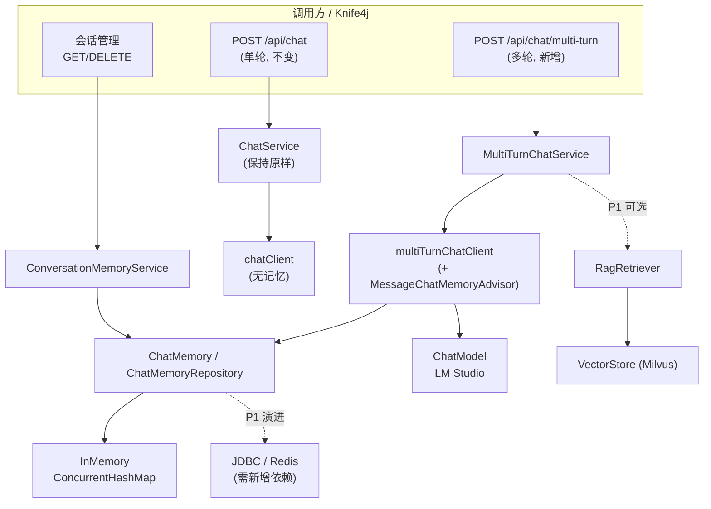

# 多轮问答接口实施计划

| 项目   | 内容                                                                            |
|------|-------------------------------------------------------------------------------|
| 工程   | `rag`（`D:\idea\rag-xmut\rag`）                                                 |
| 技术栈  | Spring Boot 4.1.1 / Spring AI 2.0.0 / Java 21 / Milvus / LM Studio(OpenAI 兼容) |
| 文档状态 | 待评审（本文件仅为计划，不含任何代码改动）                                                         |
| 适用版本 | 基于 `main` 分支 `8fad141 v1.0`                                                   |

---

## 1. 背景与目标

### 1.1 背景

当前工程只有**单轮**问答能力：

- `rag/src/main/java/com/wuyunbin/rag/controller/ChatController.java` 暴露 `POST /api/chat`
- `rag/src/main/java/com/wuyunbin/rag/service/ChatService.java` 直接把用户消息丢给模型：

  ```java
  chatClient.prompt().user(message).call().content();
  ```

  每次请求互相独立，**没有任何上下文记忆**，第二轮问“我刚才说了什么”模型无法回答。

同时工程已经具备完整的知识入库链路（`POST /api/documents` 导 TXT → `SemanticTextSplitter` 语义切片 → `VectorStore` 写入
Milvus），但**检索结果目前完全没有参与对话**。

### 1.2 目标

1. 新增多轮问答接口：以 `conversationId` 为会话标识，模型可感知同一会话的历史消息。
2. **完全向后兼容**：现有 `POST /api/chat` 的行为、路径、出入参一律不变。
3. 提供会话生命周期能力：新建会话、查询历史、清空会话。
4. （P1，可选）RAG 增强：回答前从 Milvus 检索相关片段，作为上下文注入提示词。
5. （P2，可选）流式输出（SSE），改善长回答的首字延迟。

### 1.3 非目标（本期明确不做）

- 不做用户体系 / 鉴权 / 多租户隔离（沿用当前无鉴权的工程风格）。
- 不做前端页面或 SDK 封装。
- 不修改 Milvus 的 collection/schema，不迁移向量数据。
- 不改变 `POST /api/chat` 的语义（它仍然是“无记忆单轮”）。
- 不引入分布式会话存储（此项列为 P1 的后续演进，见 10.1）。

---

## 2. 现状盘点

| 关注点           | 文件                                                                                                     | 现状说明                                                                                                 |
|---------------|--------------------------------------------------------------------------------------------------------|------------------------------------------------------------------------------------------------------|
| 单轮接口          | `rag/src/main/java/com/wuyunbin/rag/controller/ChatController.java`                                    | `POST /api/chat`，`@Tag(name="聊天接口")`                                                                 |
| 单轮服务          | `rag/src/main/java/com/wuyunbin/rag/service/ChatService.java`                                          | 直接 `call().content()`，无 advisor、无记忆                                                                  |
| 出入参           | `rag/src/main/java/com/wuyunbin/rag/dto/ChatRequest.java`、`ChatResponse.java`                          | Java `record` + Swagger `@Schema`                                                                    |
| ChatClient 装配 | `rag/src/main/java/com/wuyunbin/rag/config/ChatConfig.java`                                            | `builder.build()`，未注册任何 advisor                                                                      |
| 文档导入          | `rag/src/main/java/com/wuyunbin/rag/controller/DocumentController.java`、`service/DocumentService.java` | TXT → MD5 查重 → 切片 → 入 Milvus                                                                         |
| 语义切片          | `rag/src/main/java/com/wuyunbin/rag/splitter/SemanticTextSplitter.java`                                | 相似度阈值 0.7，块长 [50, 1000]                                                                              |
| 配置            | `rag/src/main/resources/application.properties`                                                        | 模型 `google/gemma-4-e4b`，Milvus `rag_docs`，维度 1024                                                    |
| 依赖            | `rag/pom.xml`                                                                                          | Spring AI BOM 2.0.0；`spring-ai-starter-model-openai`、`spring-ai-starter-vector-store-milvus`、Knife4j |
| 测试            | `rag/src/test/java/com/wuyunbin/rag/RagApplicationTests.java`                                          | 只有一个空的 `contextLoads`                                                                                |

### 2.1 一句话差距分析

缺少的只有三样：**会话记忆的装配**、**多轮编排的服务/接口层**、**会话生命周期管理**。底层能力（ChatClient、向量库、Swagger
文档、参数校验风格）都已具备。

---

## 3. 关键技术结论（已在本机依赖与字节码中核实）

> 本节结论直接决定实施成本，请在评审时重点确认。

### 3.1 多轮记忆「零新增依赖」即可实现

`spring-ai-starter-model-openai:2.0.0` 的 pom 中已将 `spring-ai-autoconfigure-model-chat-memory:2.0.0` 作为 compile
依赖传入，因此它**已经在当前 classpath 上**（已确认存在于 `~/.m2`）。

其 `ChatMemoryAutoConfiguration` 会自动装配两个 Bean：

| Bean                   | 类型                                                          | 条件                          |
|------------------------|-------------------------------------------------------------|-----------------------------|
| `chatMemoryRepository` | `InMemoryChatMemoryRepository`（内部为 `ConcurrentHashMap`，进程内） | `@ConditionalOnMissingBean` |
| `chatMemory`           | `MessageWindowChatMemory`（滑动窗口）                             | `@ConditionalOnMissingBean` |

**推论**：本工程不需要改 `pom.xml` 就能做多轮问答；只有“持久化 / 分布式会话”才需要新增依赖。

### 3.2 需要用到（且已核实）的 API 与常量

| API / 常量                                                          | 签名 / 值                                               | 用途                          |
|-------------------------------------------------------------------|------------------------------------------------------|-----------------------------|
| `ChatMemory.CONVERSATION_ID`                                      | 字符串常量 `"chat_memory_conversation_id"`                | 会话隔离的“钥匙”，必须显式传入            |
| `MessageChatMemoryAdvisor.builder(ChatMemory)`                    | → `Builder` → `build()`                              | 把历史消息自动拼进 prompt，并把本轮对话写回记忆 |
| `MessageWindowChatMemory.builder()`                               | `.chatMemoryRepository(repo).maxMessages(n).build()` | 控制窗口大小，防止上下文无限膨胀            |
| `ChatClient.Builder.defaultAdvisors(Advisor...)`                  | 声明式注册 advisor                                        | 构造多轮专用 ChatClient           |
| `ChatClient.Builder.clone()`                                      | 返回 `ChatClient.Builder`                              | 防御性复制 builder               |
| `AdvisorSpec.param(String, Object)`                               | 请求级 advisor 参数                                       | 传入本次请求的 `conversationId`    |
| `ChatMemory.get(String)` / `clear(String)`                        | `List<Message>` / `void`                             | 查询历史、清空会话                   |
| `ChatMemoryRepository.findConversationIds()`                      | `List<String>`                                       | 会话枚举（P1 清理任务用）              |
| `VectorStore.similaritySearch(SearchRequest)`                     | `List<Document>`                                     | RAG 检索（P1）                  |
| `SearchRequest.builder().query(q).topK(k).similarityThreshold(t)` | → `SearchRequest`                                    | 检索参数（P1）                    |

### 3.3 必须新建 ChatClient，不能直接改造现有 Bean（重要）

`BaseChatMemoryAdvisor.getConversationId(Map)` 在 context 中取不到 `ChatMemory.CONVERSATION_ID` 时返回 `null`，随后断言失败抛出
`conversationId cannot be null`。

`ChatConfig.chatClient` 是**被单轮 `/api/chat` 共用**的 Bean。如果把记忆 advisor 注册成它的默认 advisor，那么任何不带
`conversationId` 的单轮请求都会直接 500。

**结论**：多轮走独立的 `multiTurnChatClient` Bean，`ChatConfig.chatClient` 保持原样。

补充：`ChatClientAutoConfiguration.chatClientBuilder` 是 `@Scope("prototype")`，每个注入点拿到的是新实例，因此两个 Bean
之间不会互相污染 advisor 列表。

### 3.4 RAG 增强的依赖现状（影响 P1 选型）

- `QuestionAnswerAdvisor`（来自 `spring-ai-advisors-vector-store`，旧名 `spring-ai-rag`）**不在**当前 classpath，本机
  `~/.m2` 中**也不存在**该 artifact。
- 而 `spring-ai-vector-store:2.0.0` 已在 classpath，`VectorStore#similaritySearch(SearchRequest)` 可直接使用。

**结论**：RAG 阶段采用「手动检索 + 自拼 System Prompt」，避免引入必须联网下载的新依赖；若后续要联网补依赖，再评估切换到
`QuestionAnswerAdvisor`。

### 3.5 环境与构建现状（验证方式的风险提示）

- 仓库中**没有** `mvnw` / `.mvn`（虽然 `Dockerfile` 引用了 `mvnw`），`PATH` 上也**没有** `mvn`。
- `PATH` 上的 `java` 是 **17**，而工程 `java.version=21`；本机另有 `~/.jdks/openjdk-24.0.1`。
- `rag/app-run.log` 记录过一次手工 classpath 启动失败：`slf4j-simple` 与 `logback` 冲突（
  `LoggerFactory is not a Logback LoggerContext`）。`rag/run-arg.txt` 是把整个 `~/.m2` 塞进 `-cp` 拼出来的，**不可复现、不可依赖
  **。
- **建议**：验证统一走 IntelliJ IDEA 运行 `RagApplication`，或先补齐 Maven Wrapper / 安装 Maven 后用 `mvn spring-boot:run`
  。不要复用 `run-arg.txt`。

---

## 4. 总体方案



### 4.1 分层职责

| 层   | 组件                                    | 职责                                                         |
|-----|---------------------------------------|------------------------------------------------------------|
| 接口层 | `MultiTurnChatController`             | 参数校验、会话 ID 生成与透传、HTTP 语义（含 SSE）                            |
| 编排层 | `MultiTurnChatService`                | 组织 prompt、调用 `multiTurnChatClient`、组装响应                    |
| 会话层 | `ConversationMemoryService`           | 基于 `ChatMemory` 的会话创建、历史读取、清空、存在性判断                        |
| 记忆层 | `ChatMemory` + `ChatMemoryRepository` | 窗口裁剪与存储（复用 Spring AI 自动装配的 `InMemoryChatMemoryRepository`） |
| 模型层 | `multiTurnChatClient`                 | 携带 `MessageChatMemoryAdvisor` 的对话客户端                       |
| 检索层 | `RagRetriever`（P1）                    | 调 `VectorStore.similaritySearch` 并拼装资料片段                   |

### 4.2 设计取舍

1. **新增路径而非改造旧路径**：`POST /api/chat/multi-turn` 与 `POST /api/chat` 并存，避免破坏既有调用方。
2. **复用 Spring AI 记忆组件**，不手写 `List<Message>` 缓存：少写代码、少踩并发坑。
3. **会话 ID 由服务端生成**（客户端不传时），降低调用方接入成本；客户端传入时做严格格式校验。
4. **记忆窗口而非全量历史**：小参数模型（`google/gemma-4-e4b`）上下文有限，必须限制窗口。

---

## 5. 接口设计

### 5.1 主接口（P0）

**`POST /api/chat/multi-turn`**

请求体：

```json
{
  "conversationId": "3f2a9c1e-8b44-4f0a-9d21-6c9b7a1f0e33",
  "message": "那它的价格是多少？",
  "ragEnabled": false,
  "topK": 4
}
```

| 字段               | 类型      | 必填 | 说明                                        |
|------------------|---------|----|-------------------------------------------|
| `conversationId` | string  | 否  | 为空/不传 → 服务端生成新 UUID 并在响应中回传；传入 → 续接该会话上下文 |
| `message`        | string  | 是  | 用户输入，非空白，长度上限 4000 字符                     |
| `ragEnabled`     | boolean | 否  | 是否启用 RAG 检索；默认取配置 `rag.chat.rag.enabled`  |
| `topK`           | int     | 否  | RAG 召回条数；默认取配置，范围 [1, 20]                 |

响应体：

```json
{
  "conversationId": "3f2a9c1e-8b44-4f0a-9d21-6c9b7a1f0e33",
  "reply": "……",
  "round": 3,
  "ragUsed": false,
  "references": []
}
```

| 字段               | 说明                                                         |
|------------------|------------------------------------------------------------|
| `conversationId` | 本次实际使用的会话 ID（客户端首次请求后须保存复用）                                |
| `reply`          | 模型回复                                                       |
| `round`          | 该会话已完成的问答轮数（= 记忆消息数 / 2）                                   |
| `ragUsed`        | 是否实际使用了检索结果（检索为空则为 false）                                  |
| `references`     | 命中的文档片段摘要（P1 启用 RAG 时返回，含 `fileName`、`chunkIndex`、`score`） |

### 5.2 会话管理（P1）

| 方法       | 路径                                                  | 说明                                                                                                 |
|----------|-----------------------------------------------------|----------------------------------------------------------------------------------------------------|
| `POST`   | `/api/chat/conversations`                           | 显式新建会话，返回 `{"conversationId": "...", "createdAt": "..."}`                                          |
| `GET`    | `/api/chat/conversations/{conversationId}/messages` | 返回历史，`{"conversationId":"...","messages":[{"role":"USER\|ASSISTANT","content":"..."}]}`；会话不存在返回空数组 |
| `DELETE` | `/api/chat/conversations/{conversationId}`          | 清空会话，返回 `{"conversationId":"...","cleared":true}`；幂等                                               |

### 5.3 流式接口（P2）

**`POST /api/chat/multi-turn/stream`**，`produces = MediaType.TEXT_EVENT_STREAM_VALUE`，返回 `Flux<String>`。

- `MessageChatMemoryAdvisor` 同时实现了 `CallAdvisor` 与 `StreamAdvisor`，流式场景下会在流**聚合完成后**把助手消息写回记忆，无需额外处理。
- 流式分支不得与 5.1 共用同一个返回类型，需单独的 Controller 方法。

### 5.4 错误码约定

| 场景                    | HTTP                    | 响应体                                               |
|-----------------------|-------------------------|---------------------------------------------------|
| `message` 为空/超长       | 400                     | `{"error": "..."}`（与 `DocumentController` 现有风格一致） |
| `conversationId` 格式非法 | 400                     | `{"error": "conversationId 格式非法"}`                |
| 模型调用失败/超时             | 502 或 500               | `{"error": "..."}`                                |
| Milvus 不可用（仅 RAG 分支）  | 降级为普通回答，`ragUsed=false` | ——                                                |

---

## 6. 详细实施步骤

> 约定：每个阶段结束都必须能编译通过；P0 全部完成后才算特性可用。

### 阶段 0：准备与基线（约 0.5 人时）

1. 创建分支：`codex/multi-turn-chat`。
2. 记录基线：启动应用，用 Knife4j（`http://localhost:8080/doc.html`）或 curl 调用一次 `POST /api/chat`，把请求/响应存为回归对照。
3. 确认 Milvus 容器已启动（`docker compose up -d`），`POST /api/documents` 可正常导入一份 TXT。

**完成标准**：能给出“改造前 `/api/chat` 的正常响应样例”。

### 阶段 1：新增 DTO（约 1 人时）

新增文件（包 `com.wuyunbin.rag.dto`）：

| 文件                           | 类型       | 字段                                                                                            |
|------------------------------|----------|-----------------------------------------------------------------------------------------------|
| `MultiTurnChatRequest.java`  | `record` | `String conversationId, String message, Boolean ragEnabled, Integer topK`                     |
| `MultiTurnChatResponse.java` | `record` | `String conversationId, String reply, int round, boolean ragUsed, List<Reference> references` |
| `ChatMessageView.java`       | `record` | `String role, String content`                                                                 |
| `ConversationView.java`      | `record` | `String conversationId, String createdAt`                                                     |

代码骨架（含 Swagger 注解，风格对齐现有 `ChatRequest`）：

```java
@Schema(description = "多轮问答请求")
public record MultiTurnChatRequest(
        @Schema(description = "会话 ID，为空则由服务端生成", example = "3f2a9c1e-8b44-4f0a-9d21-6c9b7a1f0e33")
        String conversationId,

        @Schema(description = "用户输入内容", requiredMode = Schema.RequiredMode.REQUIRED)
        String message,

        @Schema(description = "是否启用知识库检索，缺省取服务端配置")
        Boolean ragEnabled,

        @Schema(description = "检索召回条数，范围 1-20")
        Integer topK
) {
}
```

**完成标准**：编译通过；四个 record 均带 `@Schema` 描述。

### 阶段 2：记忆与多轮 ChatClient 装配（约 1 人时）

修改 `rag/src/main/java/com/wuyunbin/rag/config/ChatConfig.java`，**新增**（不修改既有 `chatClient` 方法）：

```java
/**
 * 会话记忆：滑动窗口 + 进程内存储。
 * 覆盖 Spring AI 自动装配的 ChatMemory（其 @ConditionalOnMissingBean 会退让）。
 */
@Bean
public ChatMemory chatMemory(ChatMemoryRepository repository,
                             @Value("${rag.chat.memory.max-messages:20}") int maxMessages) {
    return MessageWindowChatMemory.builder()
            .chatMemoryRepository(repository)
            .maxMessages(maxMessages)
            .build();
}

/**
 * 多轮专用 ChatClient：默认挂载记忆 Advisor。
 * 注意：不可污染既有 chatClient（单轮请求不带 conversationId 会抛异常）。
 */
@Bean
public ChatClient multiTurnChatClient(ChatClient.Builder builder, ChatMemory chatMemory) {
    return builder.clone()
            .defaultAdvisors(MessageChatMemoryAdvisor.builder(chatMemory).build())
            .build();
}
```

**注意点**

- `ChatMemoryRepository` 由自动装配提供，直接注入即可，无需自己 `new`。
- `maxMessages` 是**消息条数**（user + assistant 各算一条），设 20 约等于 10 轮。
- `builder.clone()`：`ChatClient.Builder` 已是 prototype 作用域，`clone()` 是额外保险。

**完成标准**：应用能启动且启动日志无 `ChatMemory` 相关报错；`POST /api/chat` 行为与阶段 0 基线一致。

### 阶段 3：会话管理服务（约 2 人时）

新增 `rag/src/main/java/com/wuyunbin/rag/service/ConversationMemoryService.java`：

```java
@Slf4j
@Service
@RequiredArgsConstructor
public class ConversationMemoryService {

    private static final Pattern ID_PATTERN = Pattern.compile("^[A-Za-z0-9_-]{1,64}$");

    private final ChatMemory chatMemory;

    public String create() {
        return UUID.randomUUID().toString();
    }

    public void assertValidId(String conversationId) {
        if (conversationId != null && !ID_PATTERN.matcher(conversationId).matches()) {
            throw new IllegalArgumentException("conversationId 格式非法");
        }
    }

    public String resolveId(String conversationId) {
        return (conversationId == null || conversationId.isBlank()) ? create() : conversationId;
    }

    public List<ChatMessageView> history(String conversationId) {
        return chatMemory.get(conversationId).stream()
                .map(m -> new ChatMessageView(role(m), m.getText()))
                .toList();
    }

    public void clear(String conversationId) {
        chatMemory.clear(conversationId);
    }
}
```

**注意点**

- `role(m)` 依据 `m.getMessageType()`（`USER` / `ASSISTANT` / `SYSTEM`）映射为字符串。
- `ChatMemory` 内部对不存在的会话返回空列表，因此 `history` 不需要额外空值分支。
- 严格校验 ID 的目的：防止调用方用超长/畸形 ID 撑爆内存。

**完成标准**：单元测试覆盖 create / resolveId / history（空会话）/ clear / 非法 ID 抛异常。

### 阶段 4：多轮问答服务（约 2 人时）

新增 `rag/src/main/java/com/wuyunbin/rag/service/MultiTurnChatService.java`：

```java
@Slf4j
@Service
@RequiredArgsConstructor
public class MultiTurnChatService {

    private final ChatClient multiTurnChatClient;
    private final ConversationMemoryService conversationMemoryService;

    public MultiTurnChatResponse chat(MultiTurnChatRequest request) {
        validate(request);
        conversationMemoryService.assertValidId(request.conversationId());
        String conversationId = conversationMemoryService.resolveId(request.conversationId());

        String reply = multiTurnChatClient.prompt()
                .user(request.message())
                .advisors(a -> a.param(ChatMemory.CONVERSATION_ID, conversationId))
                .call()
                .content();

        int round = conversationMemoryService.history(conversationId).size() / 2;
        log.info("多轮问答完成 conversationId={} round={}", conversationId, round);
        return new MultiTurnChatResponse(conversationId, reply, round, false, List.of());
    }
}
```

**关键点**

- `.advisors(a -> a.param(ChatMemory.CONVERSATION_ID, conversationId))` **必须显式传**，否则 advisor 断言失败。
- **不要**手动把历史拼进 prompt：advisor 已负责“读历史 + 写回本轮”。
- `round` 从记忆条数推导，避免自增计数在清空/重启后不一致。

**完成标准**：`conversationId` 为空的请求返回新 UUID；同 ID 连续两次请求，第二次的记忆条数 ≥ 4。

### 阶段 5：多轮接口层（约 2 人时）

新增 `rag/src/main/java/com/wuyunbin/rag/controller/MultiTurnChatController.java`：

```java
@RestController
@RequestMapping("/api/chat")
@RequiredArgsConstructor
@Tag(name = "多轮问答接口", description = "基于会话记忆的多轮对话接口")
public class MultiTurnChatController {

    private final MultiTurnChatService multiTurnChatService;
    private final ConversationMemoryService conversationMemoryService;

    @PostMapping("/multi-turn")
    @Operation(summary = "多轮问答", description = "按 conversationId 维护上下文；不传则自动新建会话")
    public MultiTurnChatResponse chat(@RequestBody MultiTurnChatRequest request) {
        return multiTurnChatService.chat(request);
    }

    @PostMapping("/conversations")
    @Operation(summary = "新建会话")
    public ConversationView create() { ... }

    @GetMapping("/conversations/{conversationId}/messages")
    @Operation(summary = "查询会话历史")
    public Map<String, Object> messages(@PathVariable String conversationId) { ... }

    @DeleteMapping("/conversations/{conversationId}")
    @Operation(summary = "清空会话")
    public Map<String, Object> clear(@PathVariable String conversationId) { ... }
}
```

**注意点**

- 路径前缀与既有 `ChatController`（`@RequestMapping("/api/chat")`）相同，Spring 允许多个 Controller 共享前缀，只要**方法级路径不冲突
  **；`@PostMapping("/multi-turn")` 与既有 `@PostMapping`（空路径）不冲突。
- 可选但推荐：新增 `GlobalExceptionHandler`（`@RestControllerAdvice`），把 `IllegalArgumentException` 统一映射为 400
  `{"error": ...}`，与 `DocumentController` 的现有返回风格保持一致。

**完成标准**：Knife4j 页面能看到 4 个新接口，字段有中文说明。

### 阶段 6：配置项（约 0.5 人时）

在 `rag/src/main/resources/application.properties` 末尾追加：

```properties
# ============ 多轮会话记忆 ============
# 滑动窗口保留的消息条数（user + assistant 各计一条）
rag.chat.memory.max-messages=20
# RAG 检索开关（全局默认，可被请求参数覆盖）
rag.chat.rag.enabled=false
# 召回条数与相似度阈值
rag.chat.rag.top-k=4
rag.chat.rag.similarity-threshold=0.5
```

**完成标准**：把 `max-messages` 改为 2 后重启，第 3 轮时模型不再记得第 1 轮（验证窗口生效）。

### 阶段 7（P1）：RAG 增强（约 4 人时）

新增 `rag/src/main/java/com/wuyunbin/rag/service/RagRetriever.java`：

```java
public List<Document> retrieve(String query, int topK, double threshold) {
    SearchRequest request = SearchRequest.builder()
            .query(query)
            .topK(topK)
            .similarityThreshold(threshold)
            .build();
    return vectorStore.similaritySearch(request);
}
```

在 `MultiTurnChatService` 中，仅当 `ragEnabled = true` 时：

1. 先检索；
2. 检索为空 → 走普通多轮，`ragUsed=false`；
3. 检索非空 → 构造 System 消息拼进 prompt，例如：

```java
String system = "你是知识库问答助手。仅依据下列资料回答，资料不足时明确说明"资料中未提及"。\n"
        + "【资料 1】" + doc1.getText() + "\n"
        + "【资料 2】" + doc2.getText();
```

**注意点**

- **检索查询用原始用户问题**（一期不做指代消解）；多轮追问中的“它”会降低召回率，列为 P2 改进。
- 不要把检索片段写进 `ChatMemory`（否则每一轮都会重复携带全部资料，迅速撑爆窗口）。System 消息只在当次 prompt 中出现即可。
- 也可用 `.system(system)` 传参，效果等价；若用 `.advisors()` 里的 `param(...)` 传更复杂结构则不推荐，保持简单。

**完成标准**：导入一份含明确事实的 TXT，提问该事实能命中并回答；提问无关内容时 `ragUsed=false` 且正常作答。

### 阶段 8（P2）：流式输出（约 3 人时）

1. `MultiTurnChatService` 增加 `Flux<String> streamChat(MultiTurnChatRequest)`，使用 `.stream().content()`。
2. `MultiTurnChatController` 增加
   `@PostMapping(value = "/multi-turn/stream", produces = MediaType.TEXT_EVENT_STREAM_VALUE)`。
3. `conversationId` 需要在流开始前回传 → 建议用 `ServerSentEvent`，先发一条 `event: conversation`，再发内容块。

**完成标准**：`curl -N` 能看到逐块输出，且流结束后 `GET .../messages` 能看到完整本轮记录。

### 阶段 9：测试（约 4 人时）

详见第 8 节。

### 阶段 10：文档与收尾（约 1 人时）

1. 更新根目录 `README.Docker.md` 或新增 `rag/README.md` 的“接口清单”小节（列出单轮 / 多轮 / 文档导入三类接口）。
2. 在 Knife4j 中确认 `单轮` 与 `多轮` 接口的 `@Tag` 分组表述清晰。
3. 清理 `rag` 目录下与本次无关的临时产物（`ProbeSearch*.class`、`*-arg.txt`、`app-run.log` 等）——**建议单独开一个 chore 提交
   **，不要混进本特性。